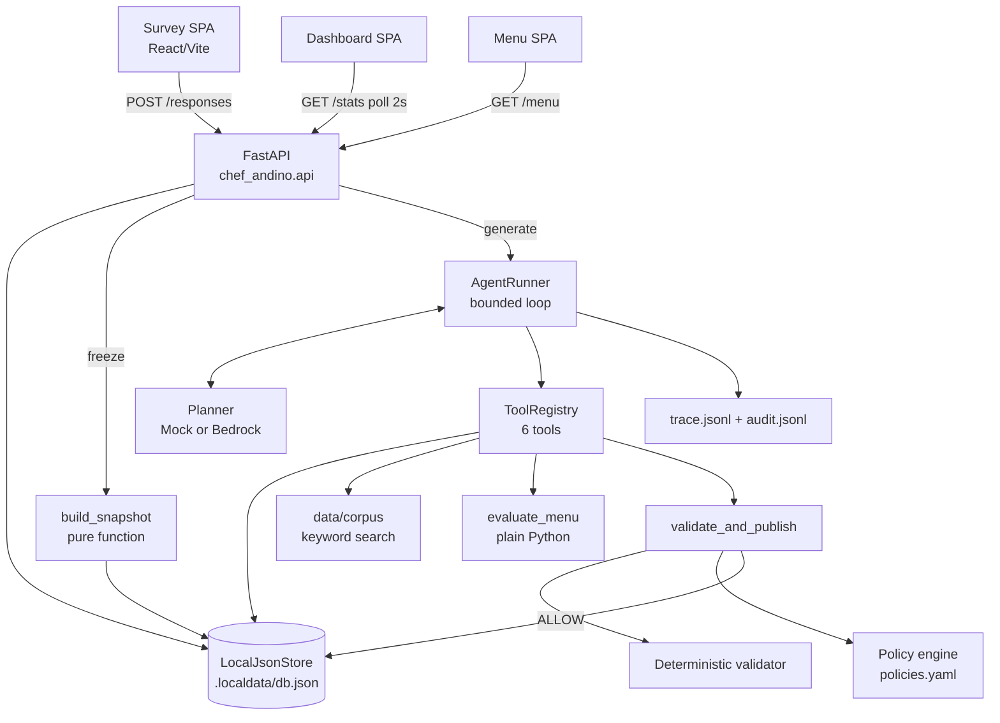
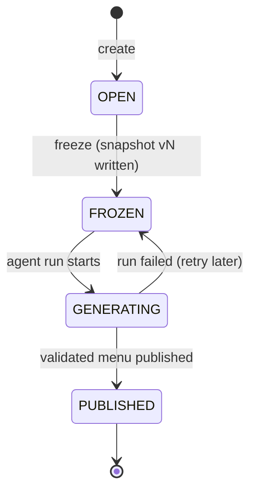
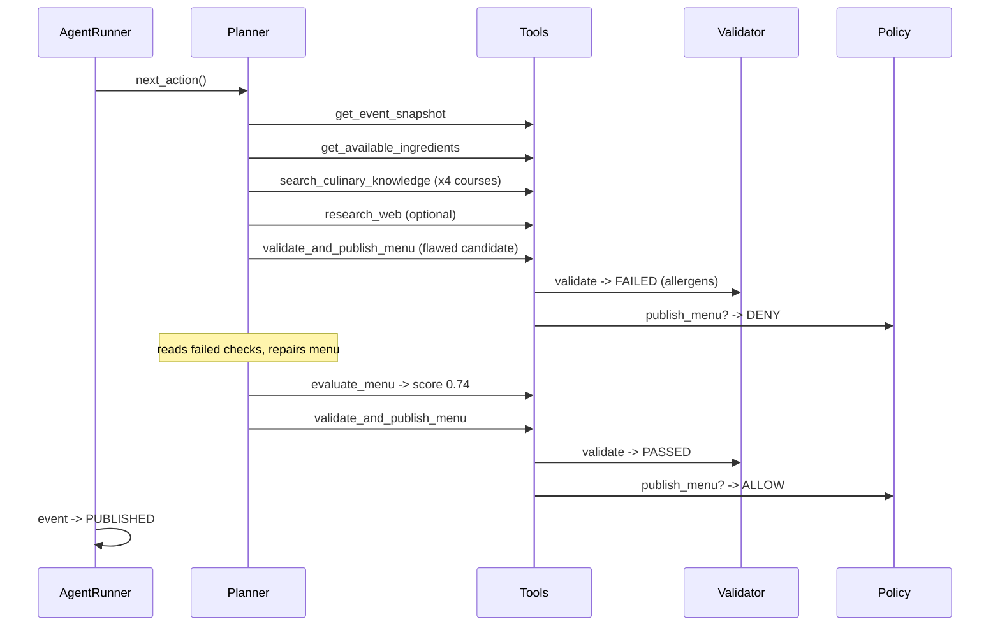
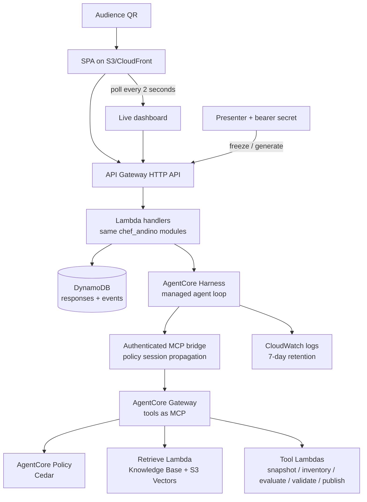

# Architecture

Chef Andino is one system with two deployments: a **local backbone** that
runs entirely offline (this repo, today) and a **cloud target** on AWS
(next phase). Both share the same four planes:

```
Experience  ->  Data  ->  Intelligence  ->  Governance
```

## The story in one paragraph

The audience scans a QR code and answers a 30-second structured survey.
Responses accumulate in storage while a dashboard shows live aggregates.
The presenter **freezes** the event: aggregation turns N individual answers
into ONE anonymous, versioned snapshot. Then the agent runs a single
mission - design the day's menu - using six tools, inside a bounded loop.
A deterministic validator and a policy engine stand between the agent and
the publish action. The published menu appears on the same QR code that fed
the agent.

## Local backbone (what runs today)



## Event lifecycle



`PUBLISHED` is terminal. Snapshots are immutable: re-freezing writes a new
version, never overwrites. The whole agent run reads a single
`snapshot_version` - that is what makes runs reproducible.

## One agent mission, step by step



Every arrow to Tools is one **iteration** charged against the budget
(`max_iterations=10`). The DENY -> repair -> ALLOW cycle is injected on
purpose in every mock run (see [agent-loop.md](agent-loop.md)) so the
governance story is always visible.

## Deployed cloud architecture



The mapping between the two diagrams is one-to-one and is tabulated in
[local-vs-cloud.md](local-vs-cloud.md). The point of the backbone is that
**nothing conceptual changes** when you swap the adapters: the loop, the
contracts, the validator and the policy rules survive the move. Browser,
Web Search, Code Interpreter, AppSync Events and WAF are intentionally out
of scope for this first educational deployment.

## Design rules the code enforces

1. **One LLM mission per event, not per participant.** Aggregation is
   deterministic software; intelligence starts only when a decision cannot
   be expressed as a reasonable set of if/else.
2. **Semantic knowledge -> RAG; real state -> tools.** The corpus knows what
   tarwi is; only the inventory tool knows there are 14 kg of it.
3. **Probabilistic intelligence, deterministic control.** The model
   proposes; validator + policy dispose. Its mistakes do not become actions.
4. **Bounded autonomy.** Budgets live in the runner, not the prompt.
5. **Internet is inspiration, not authority.** `research_web` can fail;
   the mission cannot depend on it.
6. **Observable actions, not chain-of-thought.** The trace shows what the
   agent did - which is also what you can actually audit in production.
